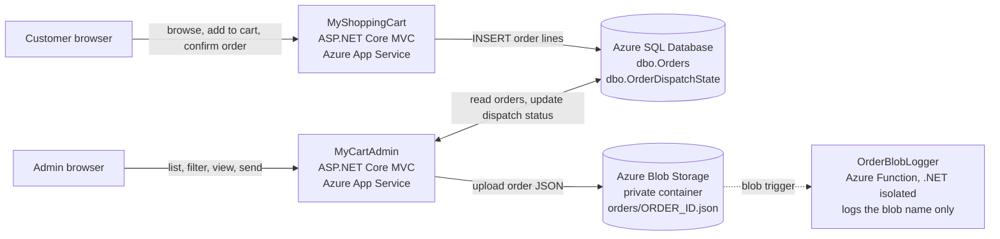
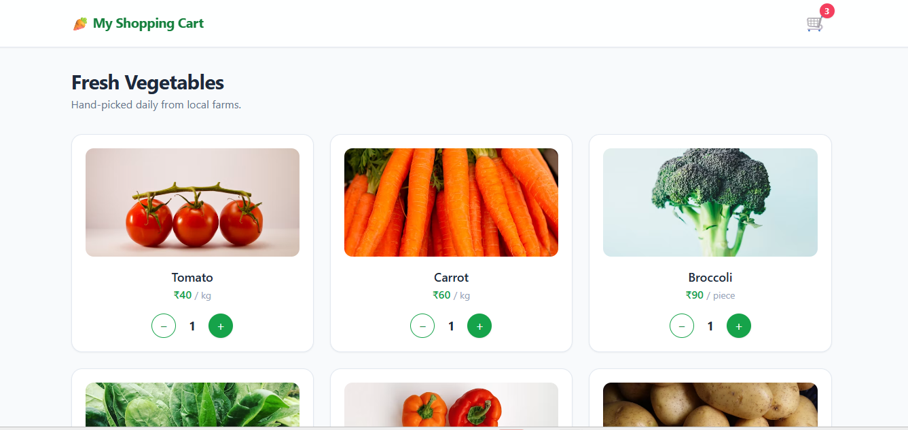
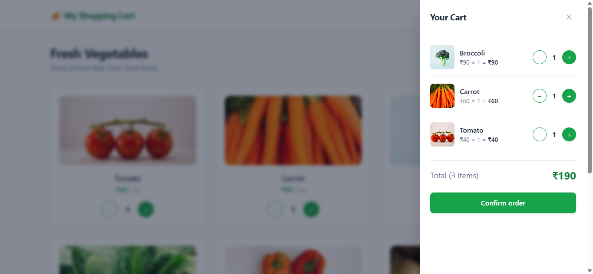
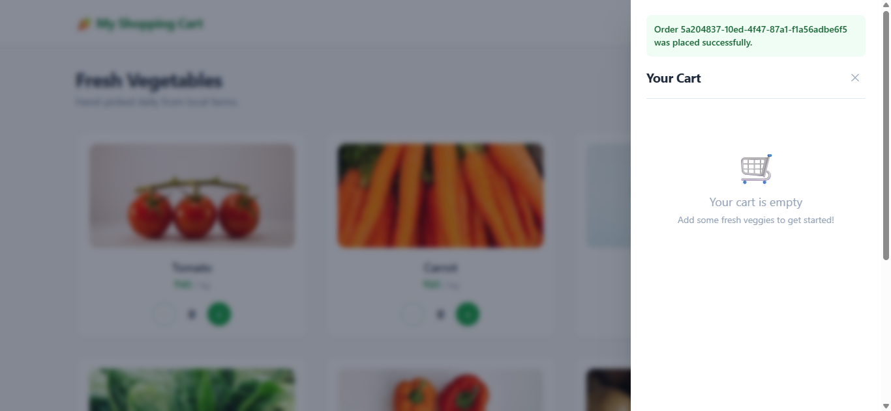
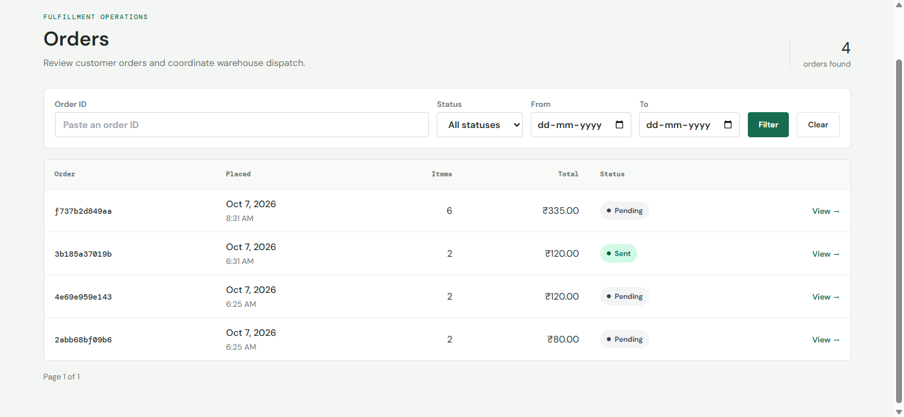
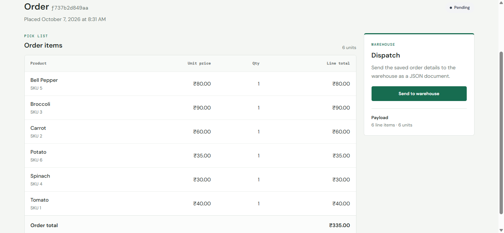
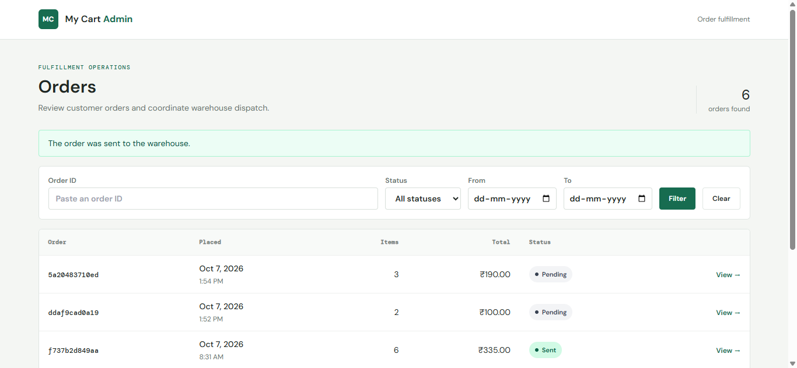
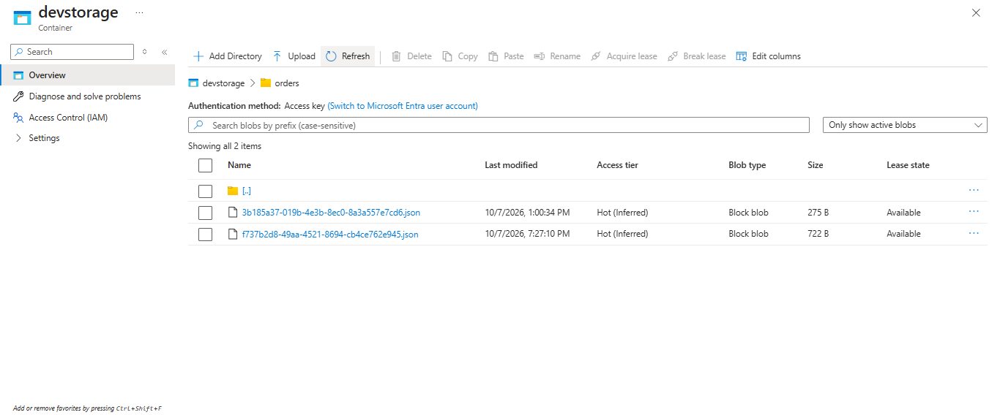

# Azure Cloud Workshop 2026

Hands-on projects from a 2-day **Microsoft Azure cloud computing workshop** (MCA programme, October 2026): static web hosting and serverless functions on Day 1, and a two-application order-management system on Day 2 built with ASP.NET Core MVC, Azure SQL Database and Azure Blob Storage.

> **Please read first - this is a workshop project.**
> The source code was provided by the workshop trainers as starter/sample material (see [Credits](#credits)). This repository documents what the code does, how it is configured and deployed on Azure, and its known limitations. It is not presented as an original product.

## What is in this repository

| Folder | What it contains |
|---|---|
| [`day-1-app-service-and-functions/`](day-1-app-service-and-functions) | A static HTML page hosted on Azure App Service, plus three Azure Functions (HTTP, timer, HTTP + Azure SQL binding) written in Node.js |
| [`day-2-order-management/`](day-2-order-management) | `MyShoppingCart` (customer app), `MyCartAdmin` (admin app) and `OrderBlobLogger` (blob-triggered Azure Function), all .NET 10 |
| [`docs/specs/`](docs/specs) | Specification documents that came with the workshop (they describe more than is implemented - see [Known limitations](#known-limitations)) |
| [`docs/screenshots/`](docs/screenshots) | Screenshots of the apps running on Azure |

## Architecture (Day 2)



The two web apps never call each other. They are connected **through the shared Azure SQL database** (`dbo.Orders`), and the admin app additionally writes to Blob Storage.

**Flow**

1. A customer adds vegetables to an in-memory cart and clicks *Confirm order*. `MyShoppingCart` writes one row per product line into `dbo.Orders` inside a SQL transaction, under a new order GUID.
2. In `MyCartAdmin` an admin sees orders grouped by order ID (pages of 20, filters for status, order ID and date range) and opens an order's details.
3. *Send to warehouse* (POST with anti-forgery token and a browser confirm dialog) moves the order's status `Pending/Failed -> Sending` in `dbo.OrderDispatchState` (serializable transaction with locking hints), uploads a JSON document to a private blob container, then marks it `Sent` (or `Failed`, which can be retried).
4. The admin can download the stored JSON through the app (it is streamed by the app; the container is not public).
5. `OrderBlobLogger` is a blob-triggered Azure Function that logs the name of a new blob. It does nothing else.

## Technologies

C# / .NET 10 - ASP.NET Core MVC (Razor views) - Microsoft.Data.SqlClient (plain parameterised ADO.NET, no ORM) - Azure.Storage.Blobs - Azure Functions (.NET isolated worker, and Node.js) - Azure App Service - Azure SQL Database - Azure Blob Storage - Kudu / ZIP deployment - Azure CLI - JavaScript (fetch API) - Tailwind CSS (via CDN) - T-SQL

## Screenshots

**Customer app**

| Catalog | Cart | Order placed |
|---|---|---|
|  |  |  |

**Admin app**

| Order list | Order details | After sending to warehouse |
|---|---|---|
|  |  |  |

**Azure Blob Storage after dispatch**



## Running Day 2 locally

**Prerequisites:** the [.NET 10 SDK](https://dotnet.microsoft.com/download), a SQL Server database (Azure SQL, SQL Server or LocalDB), and for the admin app a storage account or [Azurite](https://learn.microsoft.com/azure/storage/common/storage-use-azurite).

1. **Create the tables** (run in your SQL tool or the Azure portal *Query editor*, in this order):
   `day-2-order-management/MyShoppingCart/Database/CreateOrders.sql`, then `day-2-order-management/MyCartAdmin/Database/CreateOrderDispatchState.sql`.
2. **Provide settings without committing them.** `appsettings.sample.json` in each project shows the shape. The simplest approach on PowerShell is environment variables (a double underscore stands for a nested key):

   ```powershell
   # Customer app - required even to load the home page
   $env:ConnectionStrings__OrdersDatabase = "<your SQL connection string>"
   dotnet run --project day-2-order-management/MyShoppingCart      # http://localhost:5010

   # Admin app - in a second terminal
   $env:ConnectionStrings__OrdersDatabase = "<same SQL connection string>"
   $env:BlobStorage__ConnectionString     = "UseDevelopmentStorage=true"   # Azurite, or a real storage connection string
   $env:BlobStorage__ContainerName        = "warehouse-orders"
   $env:BlobStorage__FolderName           = "orders"
   dotnet run --project day-2-order-management/MyCartAdmin         # http://localhost:5132
   ```

   `MyCartAdmin` also declares a `UserSecretsId`, so `dotnet user-secrets set` works for it.
3. Place an order in the customer app, then open the admin app and send it to the warehouse.

> Azure itself is **not** required to run locally, but a SQL Server database is. Without a SQL connection string even the customer home page fails, because the order service is created together with the controller.

## Deploying to Azure (what the workshop did)

- **Web apps:** Azure App Service. The apps were published to a folder, zipped and deployed using ZIP deployment (the Kudu *Debug console* shows the deployed files under `wwwroot`; `az webapp deploy --type zip` is the CLI route - see `day-1-app-service-and-functions/DEPLOY_COMMANDS.txt`).
- **Configuration:** set on the App Service *Environment variables* page rather than in files: connection string `OrdersDatabase`, and app settings `BlobStorage__ConnectionString`, `BlobStorage__ContainerName`, `BlobStorage__FolderName`.
- **Database:** Azure SQL Database; tables created through the portal *Query editor*; the SQL firewall must allow the App Service.
- **Storage:** a storage account with a private container; the admin app creates the container if it does not exist.

## Configuration reference

| Setting | Used by | Purpose |
|---|---|---|
| `ConnectionStrings:OrdersDatabase` | MyShoppingCart, MyCartAdmin | SQL connection string (required) |
| `BlobStorage:ConnectionString` | MyCartAdmin | Storage connection string (required for dispatch) |
| `BlobStorage:ContainerName` | MyCartAdmin | Target container (required for dispatch) |
| `BlobStorage:FolderName` | MyCartAdmin | Virtual folder, defaults to `orders` |
| `SqlConnectionString` | Day 1 `students` function | App setting for the SQL input binding |
| `GREETING` | Day 1 `hello` function | Optional greeting text |

No real values are stored in this repository.

## Known limitations

- **No authentication or authorisation on `MyCartAdmin`.** Anyone who can reach the URL can list orders, send them and download documents. The workshop spec asks for admin-only access; it is not implemented (`LoginViewModel` exists but is unused). Do not expose it publicly.
- **The cart is one shared in-memory object**, not per user or session, and it is cleared every time the shop home page loads. Fine for a demo, not for concurrent users.
- **`OrderBlobLogger` is not fully wired up.** The trigger path is hard-coded as `devstorage/test/{name}` and no storage connection setting is named, while the admin app uploads to `<container>/orders/<id>.json`. As committed, it will not fire for the admin app's uploads unless the path and connection are changed (the spec in `docs/specs` describes configurable values). The project also references an in-process WebJobs storage package that the isolated worker model does not need.
- **No automated tests**, although the specs call for them.
- **Spec vs. implementation:** the spec describes an `OrderHeaders` / `OrderItems` migration; the code instead keeps `dbo.Orders` and adds `dbo.OrderDispatchState`.
- Product images are Unsplash URLs and the UI loads Tailwind from its CDN script (a development convenience). The SVG files in `wwwroot/images` are not used by the catalog.
- Day 1 functions are portal-style (`index.js` + `function.json`) pasted into the Azure portal editor; there is no `package.json` or local test setup.
- The code was reviewed by reading it; it was not built or run while preparing this repository.

## Skills demonstrated

Deploying and configuring Azure App Service, Azure SQL, Blob Storage and Function Apps (app settings, connection strings, CORS) - ZIP deployment and Kudu - reading and working with ASP.NET Core MVC code - parameterised SQL and transactions - JSON documents in object storage - serverless triggers (HTTP, timer, blob).

## Credits

Workshop material and starter code were provided by the trainers of the NITTE Cloud Computing / Microsoft Azure workshop (October 2026). The workshop repository this code came from: `github.com/chandantaleppady/workshop-2026`. Deployment, configuration and testing on my own Azure subscription, and this documentation, are mine.
